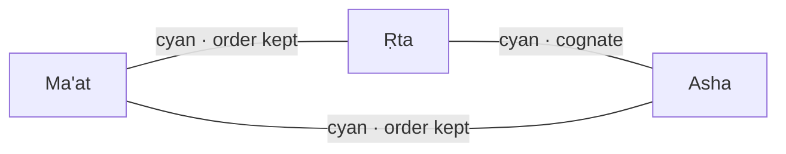
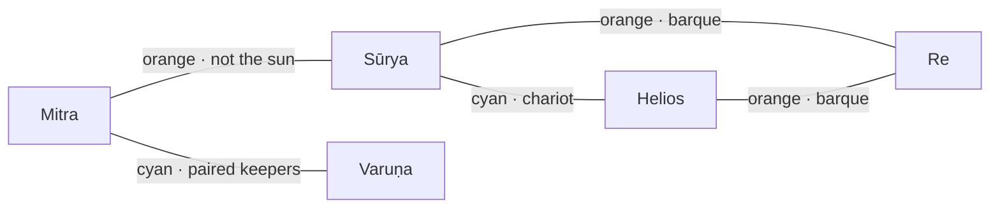
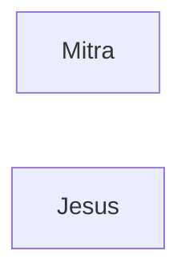
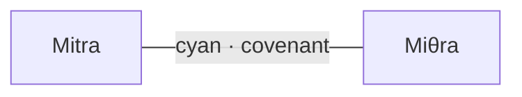
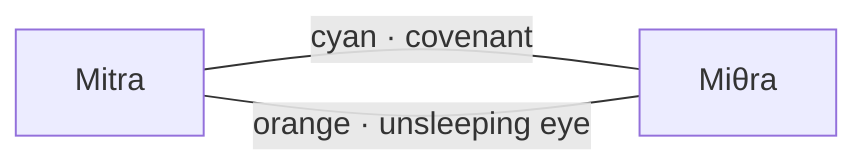
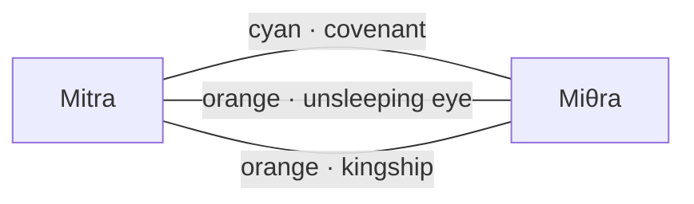
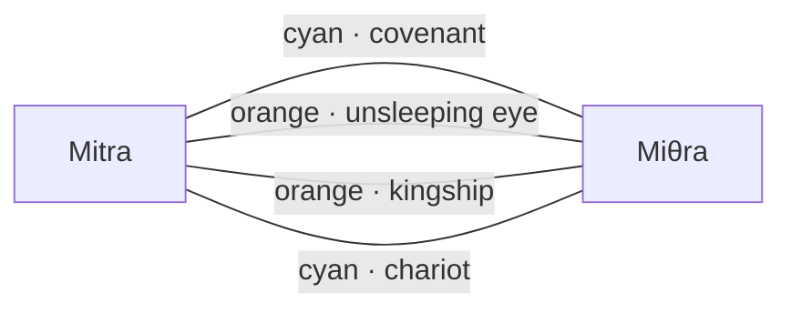
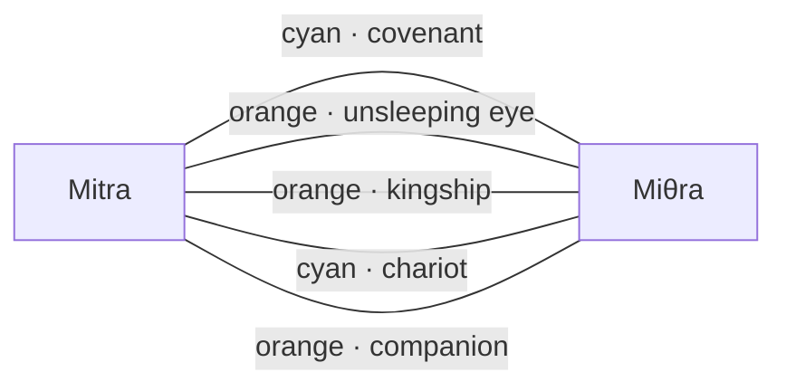
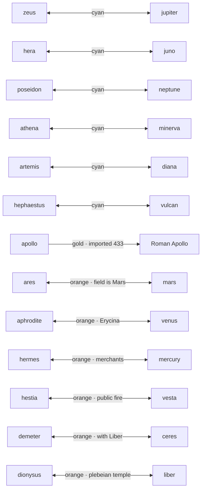

# Research plan

Living note, paired with [ROADMAP.md](ROADMAP.md). Replace a section when a pass changes the method. Date it under **Log**.

The job is to dig out schools, traditions, concepts, and their entities (deities, figures, texts), then look sideways. A finding is a lateral: two things that do not look related share an origin or an attribute. Ma'at, ṛta, and Asha share an order that must be kept. Mitra and Jesus can share a solar parallel. Rome is the middle case: a near-copy of Greek, where a partial swap of function or name is the interesting part and a plain name-swap is not.

`data/research-queue.yaml` remains the inventory of traditions to survey. This file is the order in which laterals are tested. It does not replace the queue.

---

## How a pass works

One pass, one target. A target is a likeness, a triad, or a transfer pair. Not a whole culture.

1. **Name the claim in one sentence.** Who shares what, and what would show they do not.
2. **Read the sources for each side separately.** A Greek text does not establish the Roman function. A Vedic hymn does not establish the Gathic one.
3. **List the attributes, not the story.** Chariot, eye, covenant, witness, agriculture, war-frenzy. Mark which side has which, with a citation.
4. **Sort the claim.**
   - Name-swap or translation only. Skip. That is not emergence.
   - Partial swap. Function or name moved, and something did not. This is the middle case. Encode the lateral and write what failed to transfer.
   - Shared origin or attribute, no descent required. Encode the lateral. Ma'at · ṛta · Asha is this.
   - Looks shared, sources do not reach. Leave it unclassified. Generic link only, or no edge.
5. **Encode through `/add-entry`.** One node per distinct entity that the lateral needs. Do not add the rest of the pantheon. YAML stays the store.
6. **Draw one picture.** Mermaid only. Documented laterals with typed shapes. Unclassified clusters as a loose Mermaid subgraph with generic links. No force-directed view. No 3D.
7. **Validate.** `python tools/validate.py`. Then say what the lateral confirmed, or which question it opened. Update **Log** here and **Now** in the roadmap.

A pass that only lengthens one school’s history is incomplete, even if the sources are good.

---

## Sources

Higher tier wins. A lower tier can suggest a name. It cannot settle a lateral. A blank cell stays blank. A scraped row is not an edge.

- **Primary, named passage.** The only thing that types an edge. Perseus for Greek and Latin. ETCSL for Sumerian. GRETIL or SARIT for Sanskrit. Sefaria for Hebrew and rabbinic text. Chinese Text Project. 84000 for Buddhist translations. Avestan editions for the Gathas. A standard translation is enough when the passage is named.
- **Scholarly identification.** A lexicon or encyclopedia entry that cites the passage (Oxford Classical Dictionary, Brill’s New Pauly, Stanford Encyclopedia for a philosophical school). Use it to find the passage, then cite the passage.
- **Structured name lists.** Wikidata, especially “said to be the same as,” and the Database of Religious History for coded group-level attributes. These answer “what might we have missed?” They do not answer “is this the same function?”
- **Scraped sets, including Kaggle.** A reminder that a name exists. Never a `refs` entry. Never a typed lateral. They collapse epithets and treat *interpretatio* as identity.

Obscure material does not get a special dataset. It gets the same attribute table with most cells blank, then one deep pass on the two texts that could fill a cell. `/researcher` searches, then opens two to five sources. It does not dump an encyclopedia into YAML.

---

## Medieval checkpoint

A checkpoint, not a new phase. Use it when a school’s later name exists because it had to hide, or because an opponent classified it as bad or worse.

Before that break, the method can be checked on well-mapped pairs. Ares ~ Mars checks the drawing. Ma'at · ṛta · Asha and the solar table are the origin questions. After the break, do not treat the new name as the old node. Heresiologists, condemnation lists, and underground labels are hostile sources. They prove what the winners called the school, not what the school called itself.

Ask this on the attribute table:

- Same function, sourced on both sides of the rename: one node, the later name noted.
- Name changed under pressure, continuity not sourced: two candidates. No edge, or a generic unclassified link.
- The accusation is the only link (“they are the bad ones”): a possible magenta lateral about the classification, not evidence the two schools share an origin.

There is no single year. The break sits where the tradition’s own name gives way to a hidden name or a condemnatory one, often from late antiquity into the medieval period, and at different dates in Greek, Latin, Arabic, Hebrew, and Chinese. Record the checkpoint in the pass, and in **Log**.

---

## Phases

Phases are a queue, not a ladder. A later phase can start when its sources are in hand. Do not wait to finish every solar name before drawing the triad that is already in the graph.

### 1. Representation check — Greco-Roman transfer

Not an origin. Greece and Rome are late, and Rome’s use of Greek names is a documented transfer, not where shared origins begin. The pair is useful because both sides are easy to source, so a bad drawing shows immediately.

Rome takes Greek gods by *interpretatio* and does not always keep the function. The corpus for the check is the twelve of the lectisternium of 217 (Livy 22.10.9), plus Liber, who arrives in the Ceres vow. It is not a catalogue of every Greek or Roman god, and it is not an origin. Hades, Heracles, and the Muses stay out.

**Template pair: Ares ~ Mars.**

| | Ares | Mars |
|---|---|---|
| Name | Greek war god | Roman war god, treated as the same by interpretatio |
| Function that matches | Battle, panic, slaughter | Battle |
| Function that does not | Marginal in the civic cult | Agriculture, boundaries, the state, father of Romulus |
| What the lateral is | A partial function swap, not a copy and not an independent origin | |

Steps for this pair, and for the next pair that uses the template:

1. Claim: the Roman god is not a translation of the Greek one; name the function that moved and the function that stayed or appeared.
2. Sources, each side on its own. Homer for Ares. Roman cult and early narrative for Mars (boundary, agriculture, and the founder role), plus one passage that identifies the two by interpretatio.
3. Attribute table, as above.
4. Sort: this one is a partial swap.
5. Encode only the two entities if they are missing, and one lateral. The note states the swap. No other Olympian, no other Roman god.
6. Mermaid of that pair alone. Double-headed where the identification is mutual. No arrow of descent. No straight bar.
7. Say what is confirmed (the swap) and what is still open (whether an older Italic Mars is the origin, which this pass does not decide).

The twelve are now encoded. Cyan means the sources opened here only support a translated name. Orange means a partial swap. The one gold arrow is the Apollo cult imported in 433, name untranslated. Gaps left open, and not given an edge of their own: Capitoline Juno, Neptune’s water against the sea, Menrva, woodland Diana, the Volcanalia, an older Italic Mars.

### 2. Already in the graph — Ma'at, ṛta, Asha

These three nodes exist (`maat`, `rta`, `asha`). Do not resurvey Egypt, Vedic India, or Iran.

The pass asks one question: is “order that must be kept” already the shared origin, and are the laterals between the three typed?

1. Read the existing notes and edges. Do not add gods around them.
2. If the lateral is sourced, draw the documented Mermaid: the three, the shared order, marks both ways, no descent arrow. Use an arc only if a source supports a closed loop (order fails, and the rite or the choice restores it). Otherwise leave it an open sharing.
3. File the result as confirmed, or as a question about which edge is still missing. Do not file it as settled because the names feel alike.

Confirmed 2026-11-22. The three cyan edges were already in the graph (`rta`–`maat`, `asha`–`rta`, `asha`–`maat`). No god was added. The sharing is open. It is not a feedback loop among the three. Restoration stays inside each tradition: Ma'at is re-established, Asha is chosen against Druj, ṛta is guarded by Varuṇa. Those are not edges between the three names.

### 3. Solar attribute — then the thin parallel

Sūrya is already a node. Mitra, Ra, and Helios are the comparison set. Jesus enters last, and only for the solar attribute, not as a Christian survey.

Attributes to score, each with a citation or a blank:

- Chariot or daily crossing of the sky
- Eye, or light that sees
- Witness to oaths or covenants
- Sovereignty (the sun as king, not only as lamp)
- A companion or twin who is not the sun (Mitra’s pair)

For each figure, fill the row. A lateral is allowed only where two figures share an attribute and the sources do not already make one a translation of the other.

Order inside the phase:

1. Sūrya, Helios, Ra. The chariot and the eye are the thick overlaps. Draw only the attributes that the texts support.
2. Mitra. Covenant and witness, next to the sun. This is where Mitra stops being “another sun god.”
3. Mitra ~ Jesus. The thin, easy-to-overclaim parallel. It stays a question until the same attribute is sourced on both sides. A likeness is not descent.

Unsourced cells stay blank. Blank cells are not edges.

Filled 2026-11-22 from the passages opened. `re` is the Egyptian sun already in the graph. Ra is not a second node. Jesus is not encoded.

| Attribute | Sūrya | Helios | Re | Mitra |
|---|---|---|---|---|
| Chariot or daily crossing | Ṛgveda 1.50.8–9, seven steeds | Homeric Hymn 31, golden-yoked car | Night barque, not a chariot (Amduat) | |
| Eye, or light that sees | Far-seeing, Ṛgveda 1.50.8 | Sees and hears all, Odyssey 12.320 | | Eyes that do not close, Ṛgveda 3.59.1 |
| Witness to oaths | | | | Sets peoples to their agreements, Ṛgveda 3.59.1 |
| Sovereignty | | | | Born a king, Ṛgveda 3.59.4. Not the sun’s sovereignty |
| Companion who is not the sun | | | | Paired with Varuṇa. Avestan Miθra is still open |

Laterals encoded: Sūrya–Helios cyan. Sūrya–Re and Helios–Re orange, because the barque is not the car. Mitra–Sūrya orange, because the covenant is not the sun. Mitra–Varuṇa cyan. No edge to Jesus. “Sun of righteousness” (Malachi 4:2) is a metaphor in another corpus. It does not show Mitra’s covenant on both sides.

### 4. Thinner overlaps

Only after one template pair, the triad, and the solar table exist. A thinner overlap starts unclassified: a loose Mermaid subgraph, generic links, no type. It becomes a documented lateral when the shared origin or attribute has a source. If it never does, it stays a question and gains no edge. The medieval checkpoint applies here whenever the later name is a disguise or a condemnation.

Pass 2026-11-22. One thinner overlap: Mitra ~ Jesus. The names look shared. The passages opened do not reach a shared attribute. Status: unclassified. No Jesus node. No edge. The drawing has no link. Avestan Miθra remains open.

Claim: Vedic Mitra and Jesus do not share a solar function or Mitra’s covenant in the passages opened.

A typed edge would have required one shared attribute, sourced on both sides, in the passages opened: a chariot or daily crossing, the unclosing watch of Ṛgveda 3.59.1, Mitra’s setting of peoples to their agreements, kingship that belongs to the sun, or a companion who is not the sun. The Jesus / Hebrew cells stayed blank, so no edge was typed and no generic link was drawn.

Malachi 3:20 (English 4:2) is a rising sun of righteousness with healing in its wings. It is not Mitra’s covenant. Luke 22:20 is a new covenant in blood, not Mitra setting peoples to their agreements. Luke 1:78–79 and Matthew 17:2 are light metaphors. Blank cells stay blank.

Pages opened. These citations stay in the plan. They are not refs on a graph edge: Sefaria Malachi 3.20, Mechon Mamre Malachi 3, sacred-texts RV 3.59, BibleHub Luke 1:78–79, Matthew 17:2, Luke 22:20.

Open question: does any named passage give Jesus the unclosing watch of Ṛgveda 3.59.1, or his setting of peoples to their agreements?

| Attribute | Mitra | Jesus / Hebrew |
|---|---|---|
| Chariot or daily crossing | | |
| Eye, or light that sees | Eyes that do not close, Ṛgveda 3.59.1 | |
| Witness to oaths or covenants | Sets peoples to their agreements, Ṛgveda 3.59.1 | |
| Sovereignty (sun as king) | Born a king, Ṛgveda 3.59.4. That kingship is not the sun’s | |
| Companion who is not the sun | Paired with Varuṇa | |

Confirmed: No shared attribute in the passages opened. No node. No edge.

### 5. Avestan Miθra

Pass 2026-11-22. Shared attribute. The covenant is named on both sides: Ṛgveda 3.59.1 sets peoples to their agreements, and Yt. 10.2 is the contract. One cyan lateral, undirected, from `mitra` to `avestan-mithra`. The figure is distinct because the chariot is only Yt. 10.124–125. The unsleeping eye is also named (Ṛgveda 3.59.1; Yt. 10.7 and 10.13) and is not a second edge. Kingship is named on both sides and is not the sun’s, and it is not a second edge. The companion does not match. Mills’s Gathas do not name Mithra. No Jesus, no Roman Mithras, no gold edge. `zoroastrianism` stays partial.

| Attribute | Vedic Mitra | Avestan Miθra (Yt. 10) |
|---|---|---|
| Chariot or daily crossing | | Gold chariot, four white stallions (Yt. 10.124–125). Over the Hara before the sun (Yt. 10.13) |
| Eye, or light that sees | Eyes that do not close, Ṛgveda 3.59.1 | Ten thousand eyes, sleepless (Yt. 10.7). A beneficent eye from the Hara (Yt. 10.13) |
| Witness to oaths or covenants | Sets peoples to their agreements, Ṛgveda 3.59.1 | Break not the contract (Yt. 10.2) |
| Sovereignty (the sun as king, not only as lamp) | Born a king, Ṛgveda 3.59.4. Not the sun’s sovereignty | Lord of all countries (Yt. 10.145). He brings sovereignty (Yt. 10.16). The sun is a separate sacrifice |
| Companion who is not the sun | | Sacrificed with Ahura (Yt. 10.145). The sun is named apart |

Pages opened. James Darmesteter, Mihr Yašt, Yt. 10. L. H. Mills, Gathas (Yasna 28–34, 43–46, 47–50, 51, and 53): Mithra is not named.

### 6. Unsleeping eye

Pass 2026-11-22. Partial swap. The watch is shared, and the work of the eyes did not transfer. Ṛgveda 3.59.1 beholds the peoples with eyes that do not close. Yt. 10.7 counts ten thousand eyes and calls him sleepless beside that count. Yt. 10.13 looks over the Aryan abode with a beneficent eye. One orange lateral, undirected, between `mitra` and `avestan-mithra`. The covenant edge is unchanged. No new node.

### 7. Kingship

Pass 2026-11-22. Partial swap. The rule is shared, and the act did not transfer. Ṛgveda 3.59.4 births Mitra as king, of good dominion, as disposer. Yt. 10.16 has him bring sovereignty while crossing the karshwars. Yt. 10.145 names him lord of all countries, and the sun is a separate sacrifice. One orange lateral, undirected, between `mitra` and `avestan-mithra`. The covenant edge and the eye edge are unchanged. No new node.

### 8. Chariot

Pass 2026-11-22. Shared attribute. Mitra and Varuṇa mount the chariot in the highest heaven (Ṛgveda 5.63.1). Ṛgveda 1.122.15 names that same chariot. Miθra drives a gold chariot drawn by four white stallions (Yt. 10.124–125). The before-the-sun clause of Yt. 10.13 is Avestan only and does not fill the Vedic cell. One cyan lateral, undirected, between `mitra` and `avestan-mithra`. The covenant, eye, and kingship edges are unchanged. No new node.

### 9. Companion

Pass 2026-11-22. Partial swap. The second member did not transfer. Ṛgveda 5.72.1 and 5.72.3 offer to Mitra and Varuṇa. Yt. 10.145 pairs Mithra and Ahura. The sun is a separate sacrifice in that verse. The lord-of-countries sentence stays on the kingship edge. One orange lateral, undirected, between `mitra` and `avestan-mithra`. No edge to `varuna` or `ahura-mazda`. The covenant, eye, kingship, and chariot edges are unchanged. No new node.

---

## The graph as the instrument

### Store

YAML is the store (`data/nodes.yaml`, `data/edges.yaml`). One binary edge, one type.

Use it while the question is “these two, this attribute.” It gets thin when the question is “who else has this attribute?” across many traditions, or when a likeness such as Mitra ~ Jesus is a bundle of attributes rather than one edge. Then add SQLite or Neo4j for queries. YAML remains the import. One source of truth. Do not switch in phase 1, 2, or 3.

### Documented laterals — Mermaid

One origin on the drawing. Typed edges get a shape.

| Relation | Drawing |
|---|---|
| Direction (constitute, fall, return) | one arrow |
| Mutual reinforcement, or a mutual identification | double-headed arrow |
| Reinforcing loop | a cycle, arrow around the arc |
| Balancing loop | a cycle, arrow around the arc, marked balancing |
| Recursive loop | a cycle that returns to its own start |
| Same slot, inversion, hybrid | a mark both ways, no descent arrow |

A closed loop is an arc. Do not draw it as a straight bar. Do not force an open sharing into a circle.

Mermaid is the only drawing for a finding. Documented laterals use the shapes above. An unclassified cluster is a loose Mermaid subgraph with generic links. No arrow that invents a type. No force-directed view. No 3D. Loops are planar.

The reading is a tab, the way `wwm_toolkit` puts a summary beside each quest chart. One tab is one origin. The chart keeps the typed marks. Beside it: the claim, the attribute table, what is confirmed, and what is still open. The paragraph does not go on the arrow. An open question stays in the card and does not become an edge.

When the cluster earns a source and a type, redraw it as a documented lateral and take it off the loose subgraph.

The comparison sheet is run after a drawing, as a check. If the only way to read the new nodes is to hang them on one spine, the pass has drifted. The sheet is not where the lateral is discovered.

Field stays folded for browsing. It is not the finding drawing.

---

## Drift

The roadmap and this plan stay living. Each pass edits **Now** or **Log**. Neither file is a record of intentions that outran the sources.

A new finding does one of two things:

- It confirms a lateral. The shared origin or attribute is in the sources, the edge is typed, the drawing matches the type.
- It opens a question. The resemblance is real enough to write down and not sourced enough to type. No edge, or a generic link in the unclassified drawing.

Nothing is filed as settled without the shared-origin evidence. A familiar parallel is not that evidence. A single school’s history is not that evidence. Node count is not progress.

Skip when the pass would add a god, a text, or a function that the lateral does not need.

---

## First targets

| Order | Target | Already in the graph | Done when |
|---|---|---|---|
| 1 | Greco-Roman twelve, representation check only | Yes (Livy 22.10.9, plus Liber) | Done 2026-11-22. Not an origin. Cyan, orange, and one gold import |
| 2 | Ma'at · ṛta · Asha | Yes (`maat`, `rta`, `asha`) | Done 2026-11-22. Three cyan edges. Open sharing, not a loop |
| 3 | Solar table: Sūrya, Helios, Re, Mitra, then Mitra ~ Jesus | Sūrya, Re, Helios, Mitra | Done 2026-11-22 for the four. Jesus still a question. No edge |
| 4 | Mitra ~ Jesus | Mitra yes. No Jesus node | Tested 2026-11-22. Unclassified. No edge. No link. Jesus not encoded |
| 5 | Avestan Miθra | Mitra yes. Miθra added | Encoded 2026-11-22. One cyan covenant lateral. No second edge |
| 6 | Unsleeping eye | Both nodes exist | Encoded 2026-11-22. Partial swap. One orange lateral. Covenant edge unchanged |
| 7 | Kingship | Both nodes exist | Encoded 2026-11-22. Partial swap. One orange lateral. Covenant and eye edges unchanged |
| 8 | Chariot | Both nodes exist | Encoded 2026-11-22. Shared attribute. One cyan lateral. Ṛgveda 5.63.1 and Yt. 10.124–125 |
| 9 | Companion | Both nodes exist | Encoded 2026-11-22. Partial swap. One orange lateral. Ṛgveda 5.72 and Yt. 10.145 |

---

## Log

- 2026-11-22. Plan opened. No encode in this pass.
- 2026-11-22. Source tiers added. Kaggle and other scrapes are name checks only. Medieval rename checkpoint added: a hidden or condemnatory name is not the old node unless the function is sourced on both sides. Mermaid is the only finding drawing.
- 2026-11-22. Ares ~ Mars encoded as a representation check, not an origin. Confirmed: partial swap. Battle is shared. The field lustration is Mars (Cato, Agr. 141). Ares is strife (Iliad 5.890–891). Dionysius, Ant. Rom. 1.77.1, writes the Roman grove as Ares. Open, and not required for the check: whether an older Italic Mars is the origin.
- 2026-11-22. Pantheon check extended to the twelve of Livy 22.10.9, plus Liber (Dionysius 6.17.2). Cyan where only a translated name was sourced. Orange for Mars, Venus Erycina, Mercury’s merchants, Vesta’s aniconic fire, and the Ceres–Liber temple. Gold for Apollo Medicus, vowed in 433. Not an origin. Left open: Capitoline Juno, Neptune’s water, Menrva, woodland Diana, the Volcanalia.
- 2026-11-22. Ma'at · ṛta · Asha confirmed as an open cyan sharing. No new node. No loop drawn among the three.
- 2026-11-22. Solar attribute. Helios and Mitra added. Sūrya–Helios cyan. Re joined by orange, not as a second chariot. Mitra is covenant (Ṛgveda 3.59.1), not the sun. Jesus not encoded. Avestan Miθra left open.
- 2026-11-22. Mitra ~ Jesus stayed unclassified. No Jesus node. No edge. No link on the drawing. Malachi 3:20 (English 4:2) and Luke 22:20 do not carry Mitra’s covenant. Avestan Miθra remains open.
- 2026-11-22. Avestan Miθra. Shared attribute: the covenant (Ṛgveda 3.59.1 and Yt. 10.2). One cyan lateral, undirected. New node `avestan-mithra`. The chariot is only Yt. 10.124–125. The companion does not match. Mills’s Gathas do not name Mithra. No second lateral.
- 2026-11-22. Unsleeping eye. Partial swap. One orange lateral, undirected, between `mitra` and `avestan-mithra`. The watch is shared. What failed: Ṛgveda 3.59.1 beholds the peoples with eyes that do not close; Yt. 10.7 counts ten thousand eyes and calls him sleepless beside that count; Yt. 10.13 looks with a beneficent eye. Covenant edge unchanged. No new node.
- 2026-11-22. Kingship. Partial swap. One orange lateral, undirected, between `mitra` and `avestan-mithra`. The rule is shared. What failed: birth as king (Ṛgveda 3.59.4) versus bringing sovereignty (Yt. 10.16) and lordship of countries (Yt. 10.145). Covenant edge and eye edge unchanged. No new node.
- 2026-11-22. Chariot. Shared attribute. One cyan lateral, undirected, between `mitra` and `avestan-mithra`. Ṛgveda 5.63.1 mounts the chariot in the highest heaven. Ṛgveda 1.122.15 names that same chariot. Yt. 10.124–125 is the gold chariot and four white stallions. Yt. 10.13’s before-the-sun crossing does not fill the Vedic cell. Covenant, eye, and kingship edges unchanged. No new node.
- 2026-11-22. Companion. Partial swap. One orange lateral, undirected, between `mitra` and `avestan-mithra`. The second member did not transfer: Varuṇa (Ṛgveda 5.72.1 and 5.72.3) versus Ahura (Yt. 10.145, the pair). The sun is a separate sacrifice. No edge to `varuna` or `ahura-mazda`. Covenant, eye, kingship, and chariot edges unchanged. No new node.
- 2026-11-22. Ma'at · ṛta · Asha. Shared attribute. Skip. No fourth lateral. No YAML change. The three cyan edges stay (`rta`–`maat`, `asha`–`rta`, `asha`–`maat`). Ptahhotep, Ṛgveda 5.15.2, and Yasna 28.11 each name only their own word. Restoration (Tutankhamun stela, Yasna 30.5) stays a side finding inside each tradition. `data/latest.yaml` stays `companion`.
- 2026-11-22. Roman Mithras. Unclassified. Skip. Statius, Thebaid 1.716–720 (Mithras clause 1.719–720): under the rocks of the Persian cave he twists the horns that refuse to follow. No named passage already on a graph node puts that attribute on that node. No Mithras node. No edge. Not folded into `avestan-mithra` or `mitra`. `mystery-religions` stays `stub`. `data/latest.yaml` stays `companion`. Side findings, not encodes: fruit-bearing Osiris (1.718–719); the hymn addresses Phoebus (1.696); the horns are not the Helios chariot or the Baal Cycle bull.
- 2026-11-22. Eleusis. Unclassified. Skip. Homeric Hymn to Demeter 480 (Evelyn-White 1914): blessedness of the one who has seen these things. No named passage already on another node puts that attribute on that node. No Eleusis node. No edge. The cyan interior edge is not rewritten. `mystery-religions` stays `stub`. `data/latest.yaml` stays `companion`. Side findings, not encodes: 481–482 the uninitiate’s lot; 476–479 the rites; 463–465 the daughter’s third of the year; 486–489 wealth from Plutus; 490 the name Eleusis.

